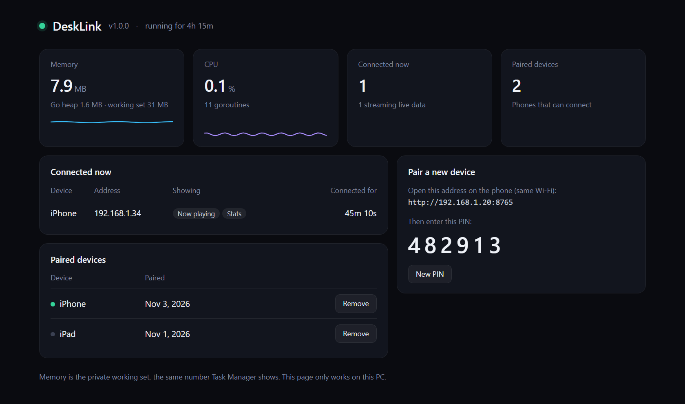

# DeskLink

**Your old phone, reborn as a Stream Deck for your PC.**

Media controls with cover art, a drag-to-set volume slider, one-tap game launcher and live CPU/GPU stats, on the phone that is already in your drawer.

- 📱 **No app to install.** Open it in the phone's browser and add it to the home screen.
- 🪶 **Featherweight.** One small `.exe`, about 8 MB of RAM, 0% CPU when idle.
- 🎮 **Made for gaming.** Launch a game and the phone turns into a live hardware monitor.
- 🔒 **Private.** Stays on your Wi-Fi. No cloud, no account, PIN pairing.
- 🕰️ **Runs on old devices.** Built and tested on an iPhone 6s.

## Screens

<table>
  <tr>
    <td width="50%"> <b>Now playing & quick actions</b></td>
    <td width="50%"> <b>Your games, one tap away</b></td>
  </tr>
  <tr>
    <td> <b>Launch animation</b></td>
    <td> <b>Live game mode stats</b></td>
  </tr>
</table>

## Get started

1. Download **[desklink.exe](https://github.com/Tunayblg/DeskLink/releases/latest)** and run it.
2. Open the address from the dashboard on your phone (same Wi-Fi).
3. Add it to the home screen and enter the PIN.
4. Done. Right-click the tray icon to have it start with Windows.

Want your own buttons, apps and games? See the **[configuration guide](docs/CONFIG.md)**.

<b>PC dashboard</b>

 

Windows 10/11 · any modern phone or tablet browser · GPU stats need an NVIDIA card
