

# DeskLink

**Your old phone, reborn as a Stream Deck for your PC.**

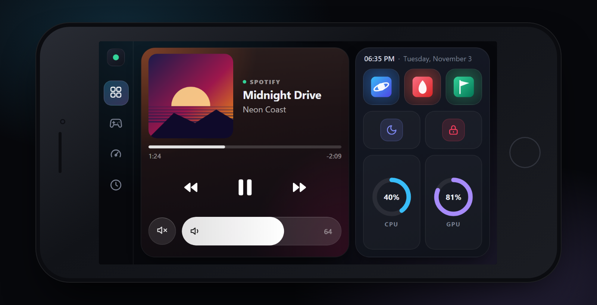

Media controls with cover art, a game launcher, per-app volume, screen brightness, mic mute and live CPU/GPU stats, on the phone that is already in your drawer.

- 📱 **No app to install on iPhone.** Open it in Safari and add it to the home screen. Android gets a small app for true full screen.
- 🪶 **Featherweight.** One small `.exe`, roughly 20–50 MB of RAM and almost no CPU.
- 🎮 **Made for gaming.** Launch a game and the phone turns into a live hardware monitor.
- 🍿 **Watch mode.** PC volume, play/pause, jump back and forward, screen brightness and a shut down button, made for the couch.
- 🎧 **Switch the sound output.** Move the PC's sound between speakers, headphones and your monitor from the phone.
- 🧑‍💻 **Developer mode (beta).** Dictate or write a prompt on the phone and it is typed into Claude, Codex, ChatGPT, a terminal or your editor, live as you speak. See what the agent is doing (thinking, running a command, editing files, done), plus quick keys and a mini trackpad.
- 🎛️ **Make it yours.** Hide or reorder any tab and switch features on or off right on the phone. Calm mode turns every animation off.
- ⭐ **Six home screen tiles.** Each opens a game, Netflix, YouTube, any website or any program.
- 🎚️ **More than buttons.** A volume mixer for each program, one-tap mic mute, and a trackpad for your PC with a window switcher to bring any open program to the front.
- 🔒 **Private.** Stays on your Wi-Fi. No cloud, no account. Pair by scanning a QR code.
- 🖥️ **Easy to manage.** A desktop dashboard for games, tiles and phones, with a built-in illustrated guide for iPhone and Android.
- 📲 **Phones and tablets.** The layout adapts to bigger screens, and it runs on old devices too (built and tested on an iPhone 6s).

## Screens

<table>
  <tr>
    <td width="50%">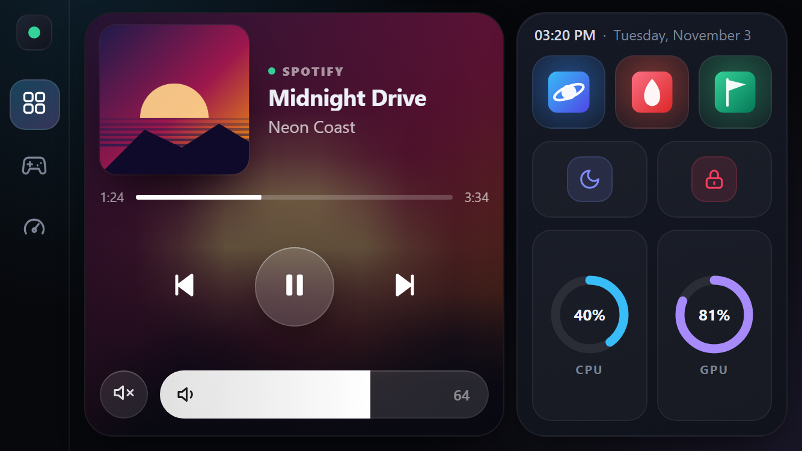 <b>Now playing, six tiles and quick actions</b></td>
    <td width="50%">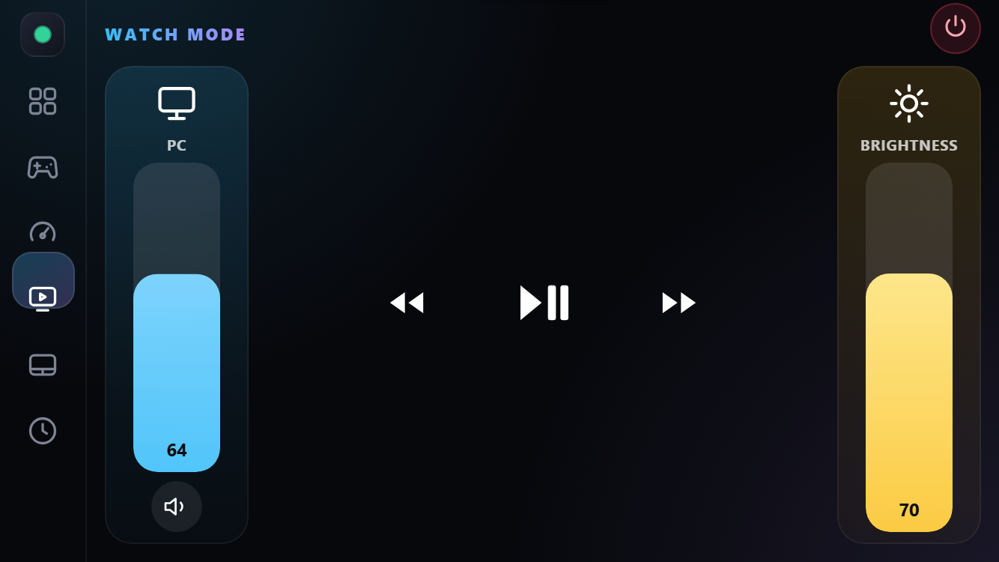 <b>Watch mode</b> for the couch: volume, transport, brightness</td>
  </tr>
  <tr>
    <td>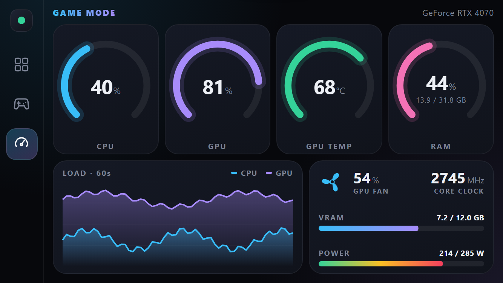 <b>Game mode</b>: live stats and a mixer</td>
    <td>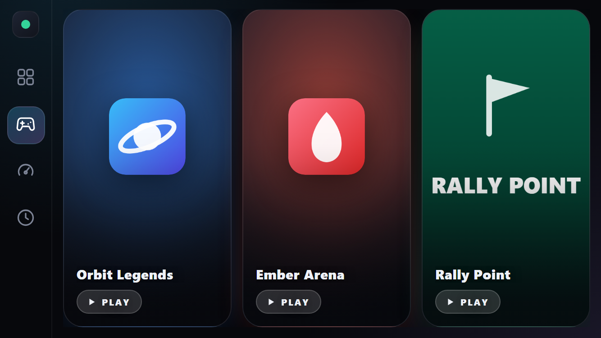 <b>Your games</b>, one tap away</td>
  </tr>
  <tr>
    <td>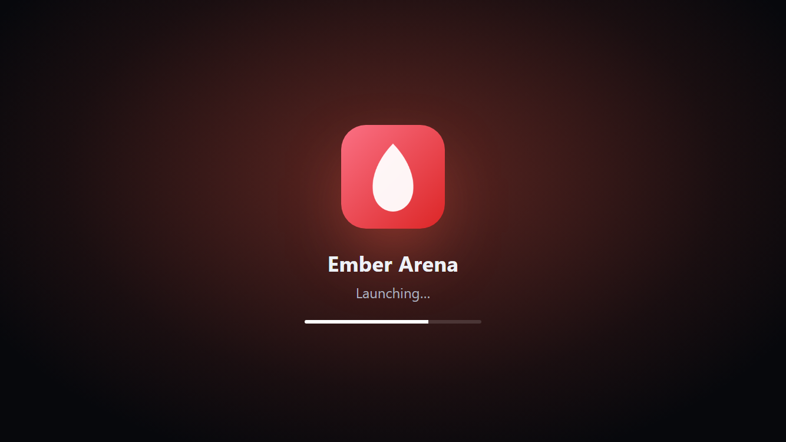 <b>Launch animation</b></td>
    <td>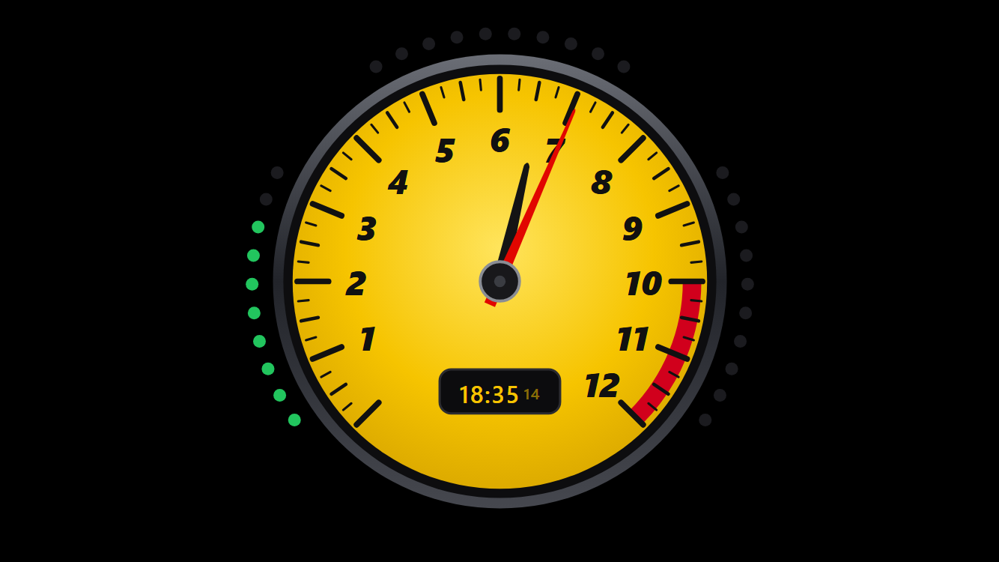 <b>Desk clock</b>, a rev-counter dial with shift lights for the seconds</td>
  </tr>
</table>

## Developer mode

Prompt your AI coding agent from across the desk. DeskLink only types into developer apps, never into chat or other programs. Dictation and typing are still in beta, so expect a few rough edges.

<table>
  <tr>
    <td width="50%">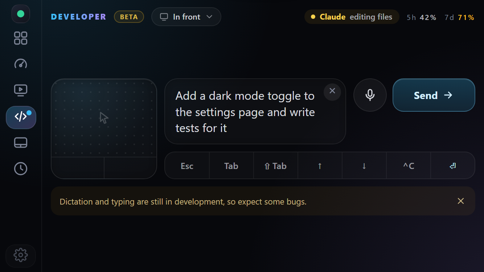 <b>Speak or type a prompt</b>, with the agent's status and plan usage on top</td>
    <td width="50%">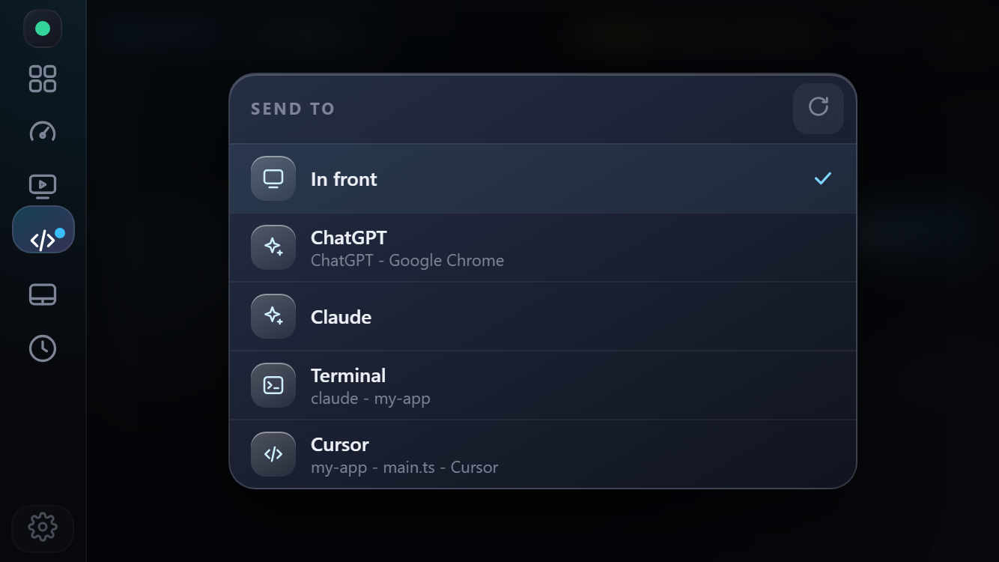 <b>Pick where it goes</b>: Claude, ChatGPT, a terminal or your editor</td>
  </tr>
</table>

## Make it yours

<table>
  <tr>
    <td width="50%">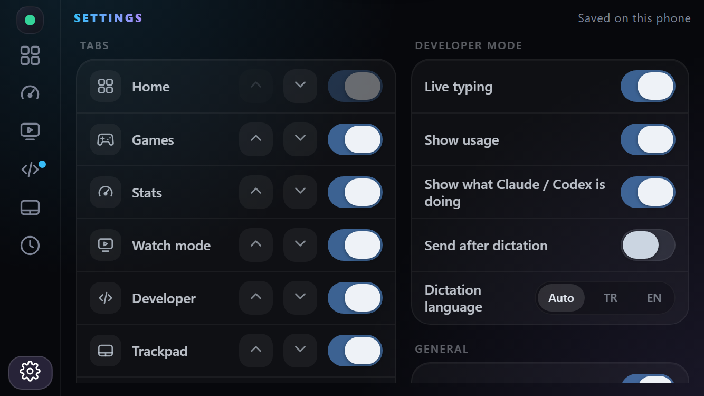 <b>Settings on the phone</b>: show, hide and reorder tabs, and turn live typing, usage, agent status and dictation options on or off</td>
    <td width="50%">

- **Tabs:** hide the ones you never use (Watch mode, Games...) and move the rest into your order. Slide a finger along the tab bar to jump between them.
- **Developer mode:** live typing, usage, agent status, send after dictation, dictation language.
- **Calm mode:** no animations at all.
- Saved on each phone, so every device can have its own layout.

Buttons, games and home screen tiles are set up on the PC, in the dashboard or the **[configuration file](docs/CONFIG.md)**.

</td>
  </tr>
</table>

## Manage it from your PC

A clean desktop dashboard lives in the tray. Add a phone by scanning a QR code, see who is connected, and set up your games and home screen tiles without touching a config file.

<table>
  <tr>
    <td width="50%">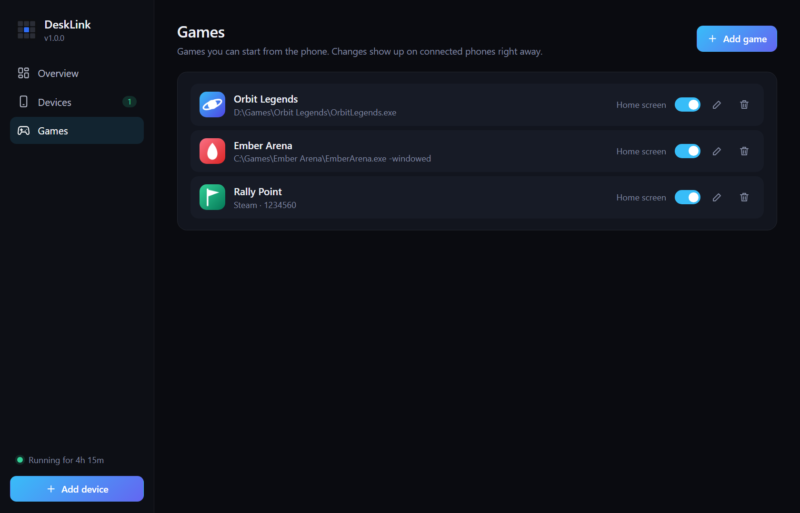 <b>Games and home screen tiles</b>, shown on the phone instantly</td>
    <td width="50%">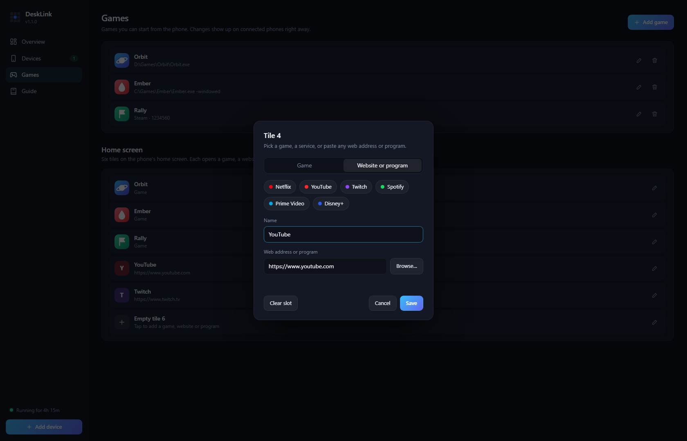 <b>Pick a tile</b>: a game, Netflix, YouTube, any address or program</td>
  </tr>
  <tr>
    <td>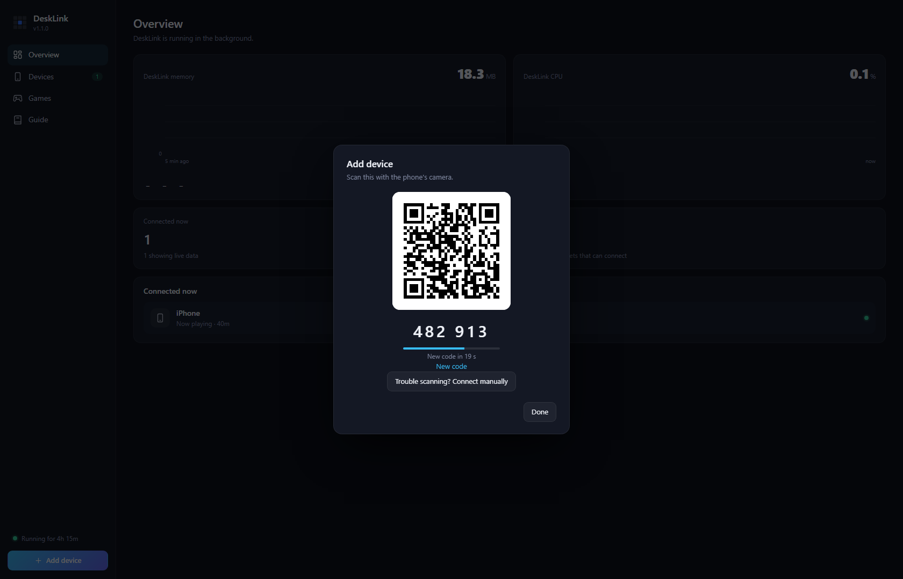 <b>Pair with a QR code</b>, the code changes every 30 s</td>
    <td>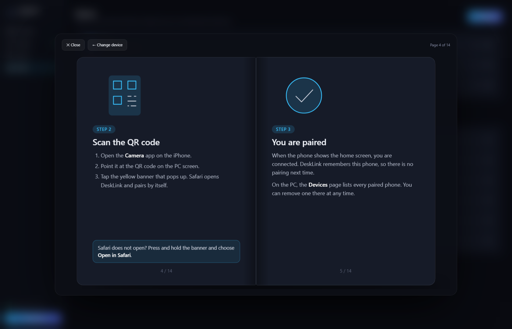 <b>A built-in guide</b>, a flip book for iPhone and one for Android</td>
  </tr>
</table>

## Get started

1. Download **[desklink.exe](https://github.com/Tunayblg/DeskLink/releases/latest)** and run it.
2. Scan the QR code in the dashboard with your phone's camera (same Wi-Fi).
3. **iPhone:** add it to the home screen from Safari. **Android:** install **DeskLink.apk** from the same page. It scans the QR code, or takes the address by hand.
4. Done. Right-click the tray icon to have DeskLink start with Windows.

The dashboard's **Guide** walks through every step, with the address and firewall details if a phone cannot connect.

> Windows may warn about the download because the app is not code-signed. Choose **More info → Run anyway**. If Smart App Control blocks it, it has to be turned off in *Windows Security → App & browser control* (it cannot be turned back on later).

Want your own buttons and layouts? See the **[configuration guide](docs/CONFIG.md)**. How it works and how it is secured: **[architecture](docs/ARCHITECTURE.md)** and **[security model](docs/SECURITY.md)**.

Windows 10/11 · any modern phone or tablet browser · GPU stats need an NVIDIA card
