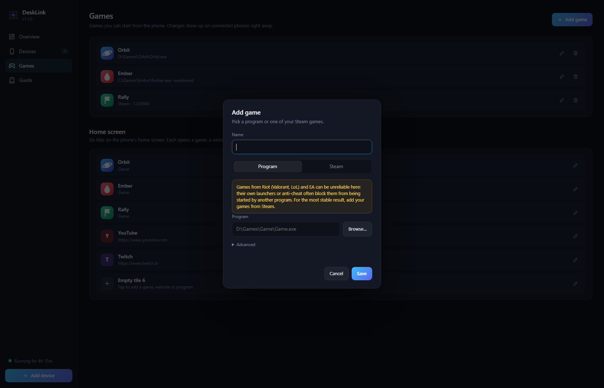
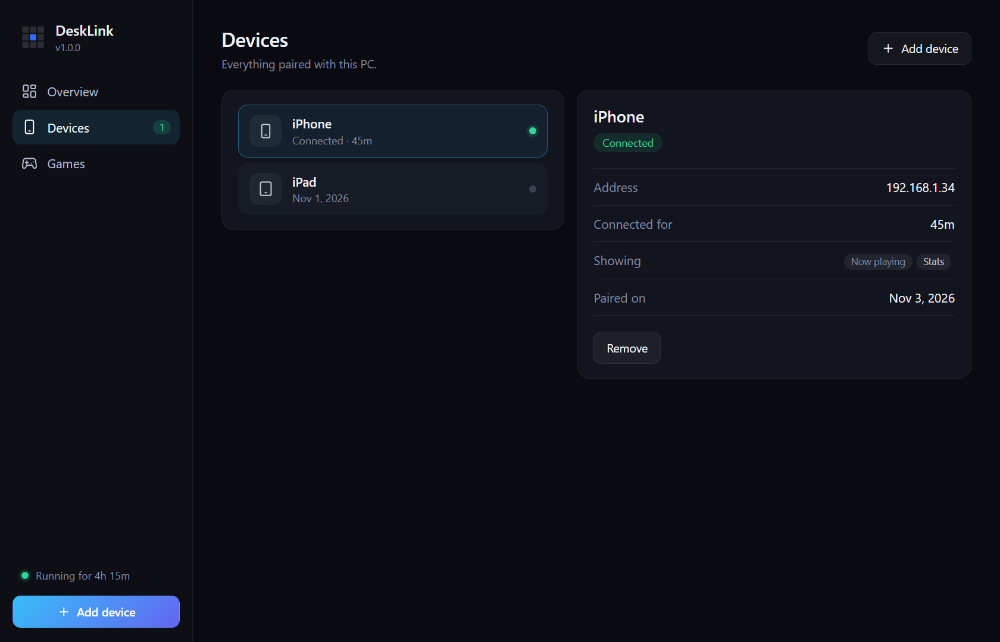

# DeskLink

**Your old phone, reborn as a Stream Deck for your PC.**

Media controls with cover art, a drag-to-set volume slider, a game launcher, per-app volume, mic mute and live CPU/GPU stats, on the phone that is already in your drawer.

- 📱 **No app to install.** Open it in the phone's browser and add it to the home screen.
- 🪶 **Featherweight.** One small `.exe`, roughly 20–50 MB of RAM and almost no CPU.
- 🎮 **Made for gaming.** Launch a game and the phone turns into a live hardware monitor.
- 🎚️ **More than buttons.** A volume mixer for each program, one-tap mic mute, a trackpad for your PC and a shut down button.
- 🔒 **Private.** Stays on your Wi-Fi. No cloud, no account. Pair by scanning a QR code.
- 🖥️ **Easy to manage.** Add games and phones from a desktop dashboard, and see what DeskLink itself uses.
- 📲 **Phones and tablets.** The layout adapts to bigger screens.
- 🕰️ **Runs on old devices.** Built and tested on an iPhone 6s.

## Screens

<table>
  <tr>
    <td width="50%"> <b>Now playing & quick actions</b></td>
    <td width="50%"> <b>Your games, one tap away</b></td>
  </tr>
  <tr>
    <td> <b>Launch animation</b></td>
    <td> <b>Live game mode stats</b></td>
  </tr>
  <tr>
    <td colspan="2"> <b>Desk clock</b>, a rev-counter dial with shift lights for the seconds. Swipe for a minimal analog face.</td>
  </tr>
</table>

## Manage it from your PC

A clean desktop dashboard lives in the tray. Add a phone by scanning a QR code, see who is connected, and set up your games without touching a config file.

<table>
  <tr>
    <td width="50%"> <b>Your games</b>, shown on the phone instantly</td>
    <td width="50%"> <b>Add any game</b>: paste a path, browse, or pick from Steam</td>
  </tr>
  <tr>
    <td> <b>Pair with a QR code</b>, the code changes every 30 s</td>
    <td> <b>All your devices</b> in one place</td>
  </tr>
</table>

## Get started

1. Download **[desklink.exe](https://github.com/Tunayblg/DeskLink/releases/latest)** and run it.
2. Scan the QR code in the dashboard with your phone's camera (same Wi-Fi).
3. Add it to the home screen.
4. Done. Right-click the tray icon to have it start with Windows.

> Windows may warn about the download because the app is not code-signed. Choose **More info → Run anyway**. If Smart App Control blocks it, it has to be turned off in *Windows Security → App & browser control* (it cannot be turned back on later).

Want your own buttons and layouts? See the **[configuration guide](docs/CONFIG.md)**.

Windows 10/11 · any modern phone or tablet browser · GPU stats need an NVIDIA card
